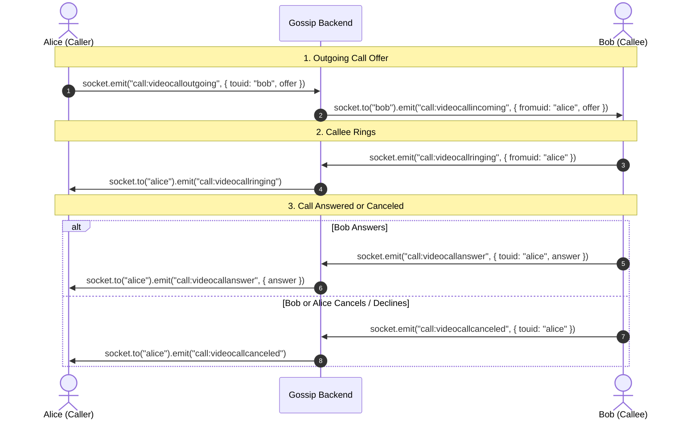

# Gossip Backend API & WebSocket Documentation

A reference guide for frontend developers integrating with the Gossip Backend. Covers all HTTP REST endpoints, Socket.IO real-time events, authentication protocols, request/response formats, and payload structures.

---

## Table of Contents
1. [Base Configuration & Authentication](#1-base-configuration--authentication)
2. [HTTP REST APIs](#2-http-rest-apis)
   - [Authentication Endpoints (`/api/auth`)](#authentication-endpoints-apiauth)
   - [Chat & Media Endpoints (`/api/chat`)](#chat--media-endpoints-apichat)
   - [User Search Endpoint (`/api/user`)](#user-search-endpoint-apiuser)
   - [AI Endpoints (`/api/ai`)](#ai-endpoints-apiai)
3. [Socket.IO Real-Time Events](#3-socketio-real-time-events)
   - [Handshake Authentication & Lifecycle](#handshake-authentication--lifecycle)
   - [Client-to-Server Events (`socket.emit`)](#client-to-server-events-socketemit)
   - [Server-to-Client Events (`socket.on`)](#server-to-client-events-socketon)
   - [WebRTC Video Call Signaling Flow](#webrtc-video-call-signaling-flow)

---

## 1. Base Configuration & Authentication

- **HTTP Base URL**: `http://localhost:5000`
- **Socket.IO Base URL**: `http://localhost:5000`

### HTTP Authentication
All protected REST endpoints require a Bearer token in the `Authorization` header:
```http
Authorization: Bearer <your_jwt_authtoken>
```

### Socket.IO Authentication
Socket.IO uses **Handshake Authentication**. When establishing a connection, supply the JWT token in the `auth` object:
```javascript
import { io } from "socket.io-client";

const socket = io("http://localhost:5000", {
  auth: {
    token: "Bearer " + authtoken, // or raw authtoken
  },
});

socket.on("connect", () => {
  console.log("Connected to Gossip backend with Socket ID:", socket.id);
});

socket.on("connect_error", (err) => {
  console.error("Connection failed:", err.message); // e.g. "Unauthorized: Missing Authorization header"
});
```

> **Important**: The server validates your token on handshake and **automatically** attaches your user session, joins your personal room (`socket.data.uid`), broadcasts your online status (`user:friendonline`) to all online friends, and marks your pending messages as delivered. **No manual `user:connection` event is needed.**

---

## 2. HTTP REST APIs

### Authentication Endpoints (`/api/auth`)

#### 1. User Signup
Registers a new user and returns an authentication token.
- **Method**: `POST`
- **Route**: `/api/auth/signup`
- **Content-Type**: `multipart/form-data`
- **Body Fields**:
  - `username` (string, required): 1–50 characters.
  - `email` (string, required): Valid email address.
  - `password` (string, required): Minimum 8 characters.
  - `fullname[firstname]` (string, required): First name (1–50 characters).
  - `fullname[lastname]` (string, required): Last name (1–50 characters).
  - `dob` (string, optional): ISO date string.
  - `profile` (file, optional): Profile picture image.
- **Success Response (201 Created)**:
  ```json
  {
    "authtoken": "eyJhbGciOiJIUzI1NiIsInR5cCI6...",
    "uid": "a1b2c"
  }
  ```
- **Error Responses**:
  - `400 Bad Request`: Validation failure on required fields or format.
  - `401 Unauthorized`: `"Please Enter Unique Email Address"`

#### 2. User Signin
Authenticates an existing user and returns their profile and auth token.
- **Method**: `POST`
- **Route**: `/api/auth/signin`
- **Content-Type**: `application/json` (or `multipart/form-data`)
- **Body**:
  ```json
  {
    "email": "user@example.com",
    "password": "password123"
  }
  ```
- **Success Response (200 OK)**:
  ```json
  {
    "authtoken": "eyJhbGciOiJIUzI1NiIsInR5cCI6...",
    "msg": "Login Successful",
    "profile": "https://res.cloudinary.com/...",
    "username": "JohnDoe",
    "fullname": {
      "firstname": "John",
      "lastname": "Doe"
    },
    "uid": "a1b2c",
    "settings": {
      "translation": {
        "language": "original",
        "alwaysTranslate": false
      },
      "summarization": {
        "format": "paragraph"
      }
    }
  }
  ```
- **Error Responses**:
  - `401 Unauthorized`: `"Login with correct Credentials"`

#### 3. Get Current User Profile
Retrieves the profile of the authenticated user.
- **Method**: `POST`
- **Route**: `/api/auth/getuser`
- **Headers**: `Authorization: Bearer <token>`
- **Success Response (200 OK)**:
  ```json
  {
    "msg": "Sussessfully Login",
    "user": {
      "profile": "https://res.cloudinary.com/...",
      "username": "JohnDoe",
      "firstname": "John",
      "lastname": "Doe",
      "email": "user@example.com",
      "uid": "a1b2c",
      "settings": {
        "translation": {
          "language": "original",
          "alwaysTranslate": false
        },
        "summarization": {
          "format": "paragraph"
        }
      }
    }
  }
  ```
- **Error Responses**:
  - `404 Not Found`: `"Automatic Login Failed"`

#### 4. Send Email OTP
Generates and sends a 6-digit verification OTP to the specified email address.
- **Method**: `POST`
- **Route**: `/api/auth/send-email-otp`
- **Content-Type**: `application/json`
- **Body**:
  ```json
  {
    "email": "user@example.com"
  }
  ```
- **Success Response (200 OK)**:
  ```json
  {
    "success": true,
    "message": "Email sent successfully"
  }
  ```
- **Error Response (500 Internal Server Error)**:
  ```json
  {
    "success": false,
    "message": "Failed to send email"
  }
  ```

---

### Chat & Media Endpoints (`/api/chat`)

#### 1. Upload Chat Image
Uploads an image to Cloudinary for use in chat messaging.
- **Method**: `POST`
- **Route**: `/api/chat/upload`
- **Headers**: `Authorization: Bearer <token>`
- **Content-Type**: `multipart/form-data`
- **Body**:
  - `image` (file, required): Image file (`image/jpeg`, `image/png`, `image/webp`, etc.)
- **Success Response (200 OK)**:
  ```json
  {
    "success": true,
    "url": "https://res.cloudinary.com/dppvlsjq1/image/upload/v1234567890/images/abc.jpg"
  }
  ```
> **Workflow**: Send the resulting `url` in the `chat:sendmessage` socket event with `type: "image"`.

#### 2. Get Friends & Conversations
Retrieves all confirmed friends (with live online presence status) and full chat message history.
- **Method**: `POST`
- **Route**: `/api/chat/getFriends`
- **Headers**: `Authorization: Bearer <token>`
- **Success Response (200 OK)**:
  ```json
  {
    "msg": "ok",
    "friends": [
      {
        "uid": "x9y8z",
        "username": "JaneDoe",
        "profile": "https://res.cloudinary.com/...",
        "online": true
      }
    ],
    "chats": [
      {
        "_id": "67123...",
        "Sender_ID": "a1b2c",
        "Receiver_ID": "x9y8z",
        "text": "Hello Jane!",
        "type": "text",
        "seen": true,
        "translatedText": [],
        "createdAt": "2026-10-24T12:00:00.000Z"
      }
    ]
  }
  ```
- **Empty Friends Response (200 OK)**:
  ```json
  {
    "error": "no friends found"
  }
  ```

---

### User Search Endpoint (`/api/user`)

#### Search Users
Searches registered users by username, UID, or full name.
- **Method**: `GET`
- **Route**: `/api/user/search?q=<query>`
- **Headers**: `Authorization: Bearer <token>`
- **Query Parameters**:
  - `q` (string, required): Search query string.
- **Success Response (200 OK)**:
  ```json
  {
    "msg": "ok",
    "users": [
      {
        "uid": "x9y8z",
        "Username": "JaneDoe",
        "ProfilePicture": "https://res.cloudinary.com/..."
      }
    ]
  }
  ```

---

### AI Endpoints (`/api/ai`)
Inference powered by Groq Cloud:
- **Vision Model**: Configured via `GROQ_VISION_MODEL` (default: `qwen/qwen3.8-27b`)
- **Text & Translation Model**: Configured via `GROQ_DEFAULT_MODEL` (default: `openai/gpt-oss-120b`)

All AI endpoints require `Authorization: Bearer <token>`.

#### 1. AI Conversational Chatbot
Generates a context-aware chatbot response with selectable tone templates.
- **Method**: `POST`
- **Route**: `/api/ai/chatbot`
- **Headers**: `Authorization: Bearer <token>`
- **Body**:
  ```json
  {
    "message": "Can you give me tips on active listening?",
    "tone": "friendly",
    "history": [
      { "role": "user", "content": "Hi!" },
      { "role": "assistant", "content": "Hello there! How can I help you today?" }
    ],
    "sessionId": "chat_session_123"
  }
  ```
  - `message` (string, required): The user prompt.
  - `tone` (string, optional): `"normal"` | `"friendly"` | `"formal"` | `"sarcastic"` | `"compassionate"` | `"humorous"`. Default: `"normal"`.
  - `history` (array, optional): Previous chat turns (`{ role: "system" | "user" | "assistant", content: string }`).
  - `sessionId` (string, optional): Session identifier.
- **Success Response (200 OK)**:
  ```json
  {
    "reply": "Active listening is all about being fully present...",
    "tone": "friendly"
  }
  ```

#### 2. Multimodal Image Analysis
Analyzes images with pre-flight URL verification (supports public HTTP/HTTPS URLs and base64 data URIs).
- **Method**: `POST`
- **Route**: `/api/ai/analyze-image`
- **Headers**: `Authorization: Bearer <token>`
- **Body**:
  ```json
  {
    "url": "https://upload.wikimedia.org/wikipedia/commons/d/da/SF_From_Marin_Highlands3.jpg",
    "prompt": "Analyze this image and describe the scene."
  }
  ```
  - `url` (string, required): Public image URL (`http://`, `https://`) or Base64 data URI (`data:image/...;base64,...`).
  - `prompt` (string, optional): Custom analysis prompt.
- **Success Response (200 OK)**:
  ```json
  {
    "data": {
      "title": "Golden Gate Bridge and San Francisco Bay",
      "description": "A scenic view of the Golden Gate Bridge stretching across the bay with city skyline in the background.",
      "details": [
        "Orange suspension bridge structure",
        "Blue water with visible fog bank",
        "Clear sky with light haze"
      ],
      "mood": "Peaceful and majestic"
    }
  }
  ```

#### 3. Unified Message Translation
Translates an array of messages into a target language.
- **Method**: `POST`
- **Route**: `/api/ai/translate`
- **Headers**: `Authorization: Bearer <token>`
- **Body**:
  ```json
  {
    "messages": [
      { "id": "msg_001", "text": "Good morning, everyone!" },
      { "id": "msg_002", "text": "Are we meeting at 2 PM?" }
    ],
    "to": "spanish"
  }
  ```
  - `messages` (array, required): Array of `{ id: string, text: string }`.
  - `to` (string, required): Target language name or code.
- **Success Response (200 OK)**:
  ```json
  {
    "messages": [
      { "id": "msg_001", "translatedText": "¡Buenos días a todos!" },
      { "id": "msg_002", "translatedText": "¿Nos reunimos a las 2 PM?" }
    ],
    "language": "spanish"
  }
  ```

#### 4. Conversation Summarization
Summarizes a chat transcript into bullet points, paragraph, or structured overview.
- **Method**: `POST`
- **Route**: `/api/ai/summarize`
- **Headers**: `Authorization: Bearer <token>`
- **Body**:
  ```json
  {
    "conversation": [
      { "username": "Alice", "message": "Should we deploy the update tonight?" },
      { "username": "Bob", "message": "Better to do it tomorrow morning when the team is online." },
      { "username": "Alice", "message": "Sounds good, 9 AM tomorrow it is." }
    ],
    "format": "bullet"
  }
  ```
  - `conversation` (array, required): Array of `{ username: string, message: string }`.
  - `format` (string, optional): `"paragraph"` | `"bullet"` | `"structured"`. Default: `"paragraph"`.

- **Success Responses (200 OK)**:
  - If `format: "bullet"`:
    ```json
    {
      "summary": [
        "Alice proposed deploying the update tonight.",
        "Bob recommended waiting for tomorrow morning when the team is available.",
        "Team agreed to schedule deployment for 9 AM tomorrow."
      ]
    }
    ```
  - If `format: "paragraph"`:
    ```json
    {
      "summary": "Alice and Bob discussed deployment timing and decided to deploy tomorrow at 9 AM."
    }
    ```
  - If `format: "structured"`:
    ```json
    {
      "summary": {
        "topic": "Deployment Timing",
        "keyPoints": [
          "Evening deployment was considered.",
          "Morning deployment chosen to ensure team availability."
        ],
        "conclusion": "Deployment scheduled for tomorrow at 9 AM."
      }
    }
    ```

---

## 3. Socket.IO Real-Time Events

### Handshake Authentication & Lifecycle

Connect to the Socket.IO server:
```javascript
const socket = io("http://localhost:5000", {
  auth: {
    token: "Bearer " + authtoken,
  },
});
```

#### Automatic Connection Lifecycle:
1. Validates the JWT and fetches user information.
2. Attaches user session to `socket.data.user` and unique UID to `socket.data.uid`.
3. Adds the user to the active memory session store (`UsersStore`).
4. Joins the user's personal room (`socket.data.uid`).
5. Emits `user:friendonline` with `{ uid: yourUid }` to all online friends.
6. Automatically marks pending undelivered messages as delivered.

#### Automatic Disconnection Lifecycle:
1. Broadcasts `user:friendoffline` with `{ uid: yourUid }` to all online friends.
2. Marks user session as disconnected in `UsersStore`.

---

### Client-to-Server Events (`socket.emit`)

#### 1. Send Message (`chat:sendmessage`)
Sends a text or image message to a recipient. If the recipient has enabled `alwaysTranslate`, text messages are automatically translated in real-time before delivery.
```javascript
// A. Text Message
socket.emit(
  "chat:sendmessage",
  {
    fromuid: myUid,
    touid: "x9y8z",
    message: "Hey Jane! How are you?",
    type: "text",
  },
  (ack) => {
    if (ack) {
      console.log("Message created and saved:", ack);
    } else {
      console.error("Failed to deliver message");
    }
  }
);

// B. Image Message
// Step 1: Upload file to POST /api/chat/upload -> returns { url }
// Step 2: Emit chat:sendmessage
socket.emit(
  "chat:sendmessage",
  {
    fromuid: myUid,
    touid: "x9y8z",
    message: uploadedCloudinaryUrl,
    type: "image",
  },
  (ack) => {
    console.log("Image message saved:", ack);
  }
);
```

#### 2. Mark Messages as Seen (`chat:seenmessages`)
Notifies the sender that their messages have been read.
```javascript
socket.emit("chat:seenmessages", {
  fromuid: "x9y8z", // UID of the friend whose messages were seen
  touid: myUid,     // Your own UID
});
```

#### 3. Send Friend Request (`user:sendchatrequest`)
Sends a friend request to a target user UID.
```javascript
socket.emit("user:sendchatrequest", myUid, targetUid, (feedback) => {
  console.log("Server feedback:", feedback);
  // Feedback options:
  // "Request Sent" | "Your Already Friends" | "Request Already Sent" |
  // "You Already Have a Request from this User" | "Invalid Uid"
});
```

#### 4. Respond to Friend Request (`user:requestanswer`)
Accepts or rejects an incoming friend request.
```javascript
socket.emit(
  "user:requestanswer",
  {
    fromuid: requesterUid, // UID of the user who sent the request
    touid: myUid,          // Your UID
    answer: true,          // true to accept, false to reject
  },
  (feedback) => {
    console.log("Server feedback:", feedback);
    // Feedback: "Request Sent" | "You Don't Have a Request from this User" |
    // "Request Already Rejected" | "Your Already Friends" | "Invalid Request"
  }
);
```

#### 5. Change Translation Language (`settings:translate:languageChange`)
Updates preferred translation language in database and session cache.
```javascript
socket.emit("settings:translate:languageChange", {
  language: "spanish", // e.g. "spanish", "french", "german", "original"
});
```

#### 6. Toggle Always Translate (`settings:translate:alwaysTranslateChange`)
Enables or disables automatic translation for incoming messages.
```javascript
socket.emit("settings:translate:alwaysTranslateChange", {
  alwaysTranslate: true,
});
```

#### 7. Change Summarization Format (`settings:summarization:formatChange`)
Updates preferred summary format.
```javascript
socket.emit("settings:summarization:formatChange", {
  format: "bullet", // "paragraph" | "bullet" | "structured"
});
```

---

### Server-to-Client Events (`socket.on`)

#### 1. Receive Chat Message (`chat:receivemessage`)
Fired when a new message is received from a peer.
```javascript
socket.on("chat:receivemessage", (chat) => {
  console.log("New incoming chat:", chat);
  // chat: {
  //   _id: string,
  //   Sender_ID: string,
  //   Receiver_ID: string,
  //   text: string,
  //   type: "text" | "image",
  //   seen: boolean,
  //   translatedText: [
  //     { language: string, translatedText: string }
  //   ],
  //   createdAt: string
  // }
});
```

#### 2. Messages Seen Receipt (`chat:seenmessages`)
Fired when the recipient marks your sent messages as seen.
```javascript
socket.on("chat:seenmessages", ({ uid }) => {
  console.log("Messages marked as seen by friend UID:", uid);
});
```

#### 3. Friend Online Status (`user:friendonline`)
Fired when a friend establishes an authenticated socket connection.
```javascript
socket.on("user:friendonline", ({ uid }) => {
  console.log("Friend came online:", uid);
});
```

#### 4. Friend Offline Status (`user:friendoffline`)
Fired when an online friend disconnects.
```javascript
socket.on("user:friendoffline", ({ uid }) => {
  console.log("Friend went offline:", uid);
});
```

#### 5. Incoming Friend Request (`user:requestfromuser`)
Fired when another user sends you a friend request.
```javascript
socket.on("user:requestfromuser", ({ uid, profile, username }) => {
  console.log(`Friend request received from ${username} (${uid})`);
});
```

#### 6. Friend Request Accepted (`successmessage`)
Fired when the recipient accepts your friend request.
```javascript
socket.on("successmessage", ({ msg, user }) => {
  console.log(msg); // e.g. "Request Accepted by JaneDoe"
  console.log("New friend profile details:", user);
});
```

#### 7. Friend Request Rejected (`errormessage`)
Fired when the recipient rejects your friend request.
```javascript
socket.on("errormessage", (message) => {
  console.warn(message); // e.g. "Request Rejected by JaneDoe"
});
```

---

### WebRTC Video Call Signaling Flow

The backend relays WebRTC signaling between users (`caller` and `callee`) without modifying SDP payloads.



#### Video Call Signaling Reference Table

| Client Emits (`socket.emit`) | Payload | Relayed Event to Peer (`socket.on`) | Relay Payload | Description |
| :--- | :--- | :--- | :--- | :--- |
| `call:videocalloutgoing` | `{ touid, offer }` | `call:videocallincoming` | `{ fromuid: senderUid, offer }` | Initiates call offer to peer |
| `call:videocallringing` | `{ fromuid }` | `call:videocallringing` | *(none)* | Notifies caller that callee device is ringing |
| `call:videocallanswer` | `{ touid, answer }` | `call:videocallanswer` | `{ answer }` | Sends SDP answer back to caller |
| `call:videocallcanceled` | `{ touid }` | `call:videocallcanceled` | *(none)* | Terminates or rejects the active call attempt |
