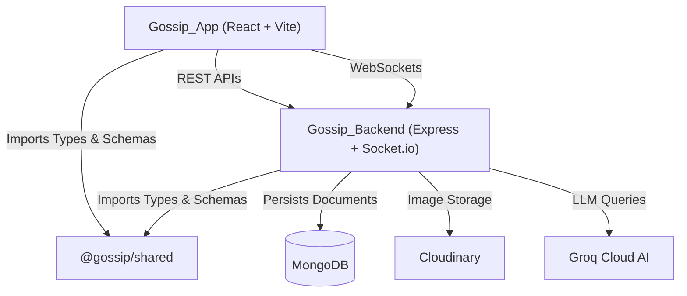

# Gossip — Full-Stack AI Chat & Communication Monorepo

**Gossip** is a real-time messaging, audio/video conferencing, and AI-assisted communication platform. It features instant one-on-one messaging, friend request management, WebRTC video calling with virtual backgrounds, AI chatbots with adjustable tones, real-time message translation, and conversation summarization.

---

## 🏗️ Monorepo Architecture

This repository is organized as an **npm workspaces monorepo**:

```
Gossip/
├── Gossip_App/             # Frontend React (Vite, TypeScript, Redux Toolkit, Tailwind)
├── Gossip_Backend/         # Backend Node.js (Express, TypeScript, Socket.io, MongoDB, Groq, Cloudinary)
├── packages/
│   └── shared/             # @gossip/shared: Single source of truth for types & Zod schemas
├── package.json            # Root workspace configuration & orchestration scripts
└── package-lock.json
```



---

## 🚀 Available Root Scripts

From the repository root, you can manage both services without manually navigating into subdirectories:

| Script | Command | Purpose |
| :--- | :--- | :--- |
| **`install:backend`** | `npm run install:backend` | Installs **only** backend & `@gossip/shared` dependencies (skips heavy frontend libraries). |
| **`install:frontend`** | `npm run install:frontend` | Installs **only** frontend & `@gossip/shared` dependencies (skips backend native C++ binaries). |
| **`build:backend`** | `npm run build:backend` | Bundles the backend using `tsup` and inlines `@gossip/shared` into `Gossip_Backend/dist/index.js`. |
| **`build:frontend`** | `npm run build:frontend` | Type-checks and creates the production Vite bundle in `Gossip_App/dist/`. |
| **`start:backend`** | `npm run start:backend` | Starts the production backend service with `node dist/index.js`. |

---

## 💻 Local Development Setup

### 1. Prerequisites
- **Node.js:** v20.x or v22.x
- **npm:** v10.x+
- **MongoDB:** Local instance or MongoDB Atlas connection string
- **Cloudinary Account:** For profile pictures and chat image uploads
- **Groq API Key:** For AI features (Chatbot, Translation, Summarization, Image Analysis)

### 2. Installation
Install all dependencies across the monorepo:
```bash
npm install
```

### 3. Environment Configuration

#### Backend (`Gossip_Backend/.env`)
Create a `.env` file inside `Gossip_Backend/`:
```env
PORT=5000
MONGODB_URI=mongodb://localhost:27017/gossip
JWT_SECRET=your_jwt_secret_key

# Cloudinary
CLOUDINARY_CLOUD_NAME=your_cloud_name
CLOUDINARY_API_KEY=your_api_key
CLOUDINARY_API_SECRET=your_api_secret

# Groq AI
GROQ_API_KEY=your_groq_api_key

# Mailer (for OTPs)
EMAIL_USER=your_email@gmail.com
EMAIL_PASS=your_email_app_password
```

#### Frontend (`Gossip_App/.env`)
Create a `.env` file inside `Gossip_App/`:
```env
VITE_API_SERVER_URL=http://localhost:5000
```

### 4. Running the Development Servers

Open two terminal windows:

* **Terminal 1: Backend**
  ```bash
  cd Gossip_Backend
  npm run dev
  ```
  *(Runs `tsx watch index.ts` with instant hot-reloading)*

* **Terminal 2: Frontend**
  ```bash
  cd Gossip_App
  npm run dev
  ```
  *(Runs `vite --host` with Vite HMR)*

---

## 🌐 Deploying to Render

This monorepo is pre-configured for optimized, isolated builds on [Render](https://render.com).

### 1. Backend Service (Web Service)
* **Environment:** `Node`
* **Root Directory:** *(leave blank / default)*
* **Build Command:**
  ```bash
  npm run install:backend && npm run build:backend
  ```
* **Start Command:**
  ```bash
  npm run start:backend
  ```
* **Environment Variables:** Add all variables from `Gossip_Backend/.env` (`MONGODB_URI`, `JWT_SECRET`, `CLOUDINARY_*`, `GROQ_API_KEY`, etc.).

### 2. Frontend App (Static Site)
* **Root Directory:** *(leave blank / default)*
* **Build Command:**
  ```bash
  npm run install:frontend && npm run build:frontend
  ```
* **Publish Directory:**
  ```
  Gossip_App/dist
  ```
* **Environment Variables:**
  * `VITE_API_SERVER_URL`: `https://your-backend-service.onrender.com`

---

## 🧪 Testing & Verification

Run backend unit tests (powered by Vitest):
```bash
cd Gossip_Backend
npm test
```

Run TypeScript compilation check across backend:
```bash
cd Gossip_Backend
npm run typecheck
```

Test production frontend build:
```bash
npm run build:frontend
```

---

## 📄 License
ISC License. Built with ❤️ by the Gossip team.
